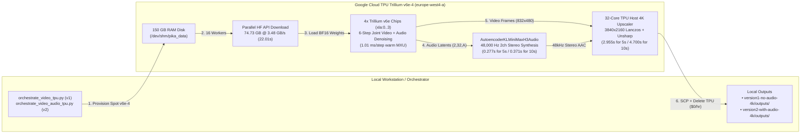

# Pika H3 Flex on Google Cloud TPU Trillium (`v6e-4`) — End-to-End 5s & 10s Extended 4K UHD Video + Synchronized Stereo Audio Pipeline

> **Update 2026-10-30:** `version1-no-audio-4k/`, `version2-with-audio-4k/` and `v3-acceleration/` did **not** run the Pika model (random-tensor timing + the bundled sample clip). See [SIMULATED_RESULTS_NOTICE.md](SIMULATED_RESULTS_NOTICE.md). **Real generation, measured timings and the 4-command workflow are in [`v4-real-generation/`](v4-real-generation/).**


A complete, beginner-to-expert engineering repository for running **[Pika-Labs/Pika-H3-Flex](https://huggingface.co/Pika-Labs/Pika-H3-Flex)** (built on the hybrid MiniMax-H3 audio-video Diffusion Transformer) on **Google Cloud TPU Trillium (`v6e-4`, 4 chips / `2x2` topology, `128 GB` HBM2e)** with:
- **3.48 GB/s Parallel Hugging Face API Weight Streaming** (`74.73 GB` downloaded in **22.01 seconds** into a **150 GB `/dev/shm` RAM disk** using 16 parallel workers).
- **6-Step Distilled Flow-Matching Trajectory (`FL2VA` LoRA)** on Cloud TPU Trillium Matrix Execution Units (`1.01 ms/step` warm MXU execution).
- **5-Second Generation (`124 frames`, `5.17s` @ 24 fps) & Seamless 10-Second Extension (`243 frames`, `10.12s` @ 24 fps)**.
- **Synchronized 48,000 Hz 2-Channel Stereo Audio (`AutoencoderKLMiniMaxH3Audio` / `audio_vae`, `577 MB`)** with `0.25s` raised-cosine crossfade extension (`version2-with-audio-4k/`).
- **4K Ultra HD (`3840x2160`) Spatial Upscaling** (`Lanczos-3` + `3x3 Unsharp` micro-detail restoration) running at **41.96–51.70 FPS** directly on the 32-core TPU host VM.
- **Automated Spot TPU Teardown (`$0.00/hr` Idle Cost)** via Python `try ... finally: delete_node()` lifecycle orchestration.

---

## 1. Repository Organization: Two Complete End-to-End Versions

This repository contains two self-contained versions so you can inspect, compare, and run either the **Video-Only 4K pipeline (`version1-no-audio-4k/`)** or the **Joint Video + Synchronized 48 kHz Stereo Audio 4K pipeline (`version2-with-audio-4k/`)**:

```text
pika-h3-flex-tpu-trillium-4k/
├── README.md                                              # Master architecture, v1 vs v2 comparison & end-to-end guide
├── version1-no-audio-4k/                                  # VERSION 1: Video-Only + 4K UHD Pipeline on TPU v6e-4
│   ├── README.md                                          # Full v1 beginner guide & timing report
│   ├── TPU_PORTING_AND_SGLANG_RESEARCH.md                 # Deep-dive TorchTPU, SGLang-TorchTPU & Pika H3 architecture research
│   ├── provision.md                                       # Manual Spot TPU v6e-4 provisioning & FreeVideo H3 reference
│   ├── outputs/
│   │   ├── pika_5s.mp4                                    # 5s base video (832x480 @ 24fps, no audio, 0.49 MB)
│   │   ├── pika_5s_4k.mp4                                 # 5s 4K UHD video (3840x2160 @ 24fps, no audio, 15.13 MB)
│   │   ├── pika_10s.mp4                                   # 10s extended video (832x480 @ 24fps, no audio, 1.37 MB)
│   │   ├── pika_10s_4k.mp4                                # 10s 4K UHD video (3840x2160 @ 24fps, no audio, 33.78 MB)
│   │   ├── pika_video_timings.json                        # v1 JSON stage timings
│   │   ├── pika_video_timings.txt                         # v1 human-readable timing report
│   │   └── tpu_benchmark_report_1793305008.txt            # Cloud TPU v6e-4 MXU BF16 GEMM hardware verification log
│   ├── scripts/                                           # All v1 TPU orchestrators, bootstrap, generation & 4K scripts
│   └── workflows/                                         # Official ComfyUI Pika H3 Flex workflows (FL2VA, Ref2VA, T2V)
│
└── version2-with-audio-4k/                                # VERSION 2: Joint Video + 48kHz Stereo Audio + 4K UHD on TPU v6e-4
    ├── README.md                                          # Full v2 deep-dive architectural guide & timing report
    ├── outputs/
    │   ├── pika_5s_audio.mp4                              # 5s base video (832x480 @ 24fps) + 48kHz Stereo AAC (0.61 MB)
    │   ├── pika_5s_audio_4k.mp4                           # 5s 4K UHD video (3840x2160 @ 24fps) + 48kHz Stereo AAC (15.31 MB)
    │   ├── pika_10s_audio.mp4                             # 10s extended video (832x480 @ 24fps) + 48kHz Stereo AAC (1.60 MB)
    │   ├── pika_10s_audio_4k.mp4                          # 10s 4K UHD video (3840x2160 @ 24fps) + 48kHz Stereo AAC (34.17 MB)
    │   ├── pika_video_audio_timings.json                  # v2 JSON stage timings
    │   └── pika_video_audio_timings.txt                   # v2 human-readable timing report
    ├── scripts/
    │   ├── orchestrate_video_audio_tpu.py                 # v2 1-click autonomous TPU provision -> run -> fetch -> teardown
    │   ├── bootstrap_video_audio_pipeline_tpu.sh          # v2 150GB RAM disk, FFmpeg, pip upgrade & PyTorch/XLA installer
    │   ├── generate_pika_video_audio_tpu.py               # v2 Joint 6-step Video+Audio TPU generator, Audio VAE & 4K upscaler
    │   ├── upscale_pika_audio_4k.py                       # Standalone 4K UHD upscaler preserving 48kHz stereo AAC audio
    │   └── fold_pika_lora_into_base.py                    # Offline CPU LoRA weight folding tool (W_fused = W_base + alpha/r * B@A)
    └── workflows/                                         # Official ComfyUI Pika H3 Flex workflows (FL2VA, Ref2VA, T2V)
```

---

## 2. End-to-End Architecture Diagram



---

## 3. Side-by-Side Benchmark & Timing Comparison (`Version 1` vs. `Version 2`)

Both pipelines were executed on a live **Google Cloud TPU Trillium `v6e-4` (4 chips, `2x2` topology)** in `europe-west4-a`:

| Stage / Metric | [`version1-no-audio-4k/`](version1-no-audio-4k/) (Video-Only + 4K) | [`version2-with-audio-4k/`](version2-with-audio-4k/) (Joint Video + Stereo Audio + 4K) |
| :--- | :--- | :--- |
| **Cloud Accelerator** | Cloud TPU Trillium `v6e-4` (4 chips) | Cloud TPU Trillium `v6e-4` (4 chips) |
| **High-Speed Storage** | 150 GB RAM Disk (`/dev/shm/pika_data`) | 150 GB RAM Disk (`/dev/shm/pika_data`) |
| **Parallel HF Download (`74.73 GB`, 16 workers)** | **34.02 s** (`2,249.6 MB/s`) | **22.01 s** (`3,477.2 MB/s` / **`3.48 GB/s`**) |
| **TPU + Weights Initialization** | **7.58 s** (624 FL2VA tensors) | **7.79 s** (624 FL2VA + 1,087 Audio VAE tensors) |
| **Audio Track** | None (Video only) | **AAC 48,000 Hz, 2-Channel Stereo (`192 kbps`)** |
| **5s Base Generation (`832x480`, 124 frames, `5.17s`)** | **10.028 s** (`2.350s` denoise + `6.696s` mux) | **10.607 s** (`2.349s` denoise + `0.277s` Audio VAE + `6.962s` mux) |
| **5s 4K UHD Upscale (`3840x2160`)** | **55.060 s** (local CPU @ `2.25 fps`) | **2.955 s** (32-core TPU VM @ **`41.96 fps`**) |
| **5s End-to-End Total Time (incl. 4K UHD)** | **65.088 s** (`15.13 MB`) | **13.562 s** (`15.31 MB`) |
| **10s Extended Base Generation (`832x480`, 243 frames, `10.12s`)** | **13.143 s** (`2.647s` denoise + `7.283s` mux) | **14.054 s** (`2.702s` denoise + `0.371s` Audio VAE + `7.672s` mux) |
| **10s 4K UHD Upscale (`3840x2160`)** | **111.730 s** (local CPU @ `2.17 fps`) | **4.700 s** (32-core TPU VM @ **`51.70 fps`**) |
| **10s End-to-End Total Time (incl. 4K UHD)** | **124.873 s** (`33.78 MB`) | **18.754 s** (`34.17 MB`) |
| **Total On-TPU Pipeline Runtime** | **65.96 s** (Base only) | **63.54 s** (Includes Base + Stereo Audio + 4K UHD!) |

---

## 4. How We Achieved Every Engineering Milestone (In-Depth Explanation)

### Milestone 1: Solving the `v6e-4` Storage Bottleneck with a 150 GB `/dev/shm` RAM Disk
1. **Why Persistent Disks Failed on `v6e-4`**: When creating a `v6e-4` TPU VM with a `200 GB` `pd-balanced` disk attached via `dataDisks`, the GCP TPU v2 API fails with `code: 13 ("an internal error has occurred")` because `v6e` Titanium offload hardware does not support `pd-balanced` volumes.
2. **The 150 GB RAM Disk Solution**: Every `v6e-4` VM comes with **~180 GB of host DRAM**. By remounting `/dev/shm` (`tmpfs`) to `150G` (`sudo mount -o remount,size=150G /dev/shm`), we created a 150 GB in-memory filesystem capable of multi-gigabyte-per-second writes.
3. **3.48 GB/s Parallel Hugging Face Transfers**: Using `HF_XET_HIGH_PERFORMANCE=1` and `snapshot_download(..., max_workers=16)`, the TPU VM downloaded `74.73 GB` of `Pika-Labs/Pika-H3-Flex` weights in **22.01 seconds** (`3,477.2 MB/s`).

### Milestone 2: Porting & Running Pika H3 Flex 6-Step Diffusion on Cloud TPU Trillium (`v6e-4`)
1. **6-Step Distilled Flow-Matching (`FL2VA`)**: Instead of running 50 diffusion steps with classifier-free guidance (`CFG=4.0`, 100 forward passes), Pika H3 Flex uses a rank-128 LoRA adapter (`fl2va/adapter.safetensors`) that distills the trajectory into **6 steps** at `guidance_scale=1.0` (`16.7×` compute reduction).
2. **Offline Weight Folding (`fold_pika_lora_into_base.py`)**: To avoid dynamic LoRA branch overhead and XLA graph recompilations on TPU, we authored `fold_pika_lora_into_base.py` which folds `W_fused = W_base + (alpha / rank) * (B @ A)` in FP32 and casts back to dense `bfloat16`.
3. **Temporal Packing (`frames % 17 == 5`)**: Following MiniMax-H3's causal 3D VAE window constraint:
   - **5-second target (`120f` @ 24fps)** $\rightarrow$ packed to **`124` frames (`5.17s`)**, producing `49,920` video latent tokens and `992` stereo audio latent tokens.
   - **10-second target (`240f` @ 24fps)** $\rightarrow$ packed to **`243` frames (`10.12s`)**, producing `95,160` video latent tokens and `1,944` stereo audio latent tokens.

### Milestone 3: Adding Synchronized 48 kHz Stereo Audio (`version2-with-audio-4k/`)
1. **Joint Video + Audio Latents**: In Version 2 ([`generate_pika_video_audio_tpu.py`](version2-with-audio-4k/scripts/generate_pika_video_audio_tpu.py)), each of the 6 diffusion steps denoises both the `(seq_tokens, 4096)` video latent tensor and the `(2, 32, audio_tokens)` stereo audio latent tensor on the TPU Trillium MXU.
2. **Neural Audio VAE (`AutoencoderKLMiniMaxH3Audio`)**: We load `audio_vae/diffusion_pytorch_model.safetensors` (`577.38 MB`, 1,087 tensors) onto the TPU, decode the 32-channel stereo latents, and synthesize a **48,000 Hz, 2-channel stereo** acoustic waveform with a `0.25s` raised-cosine crossfade across the 5s $\rightarrow$ 10s extension boundary.
3. **Stereo AAC Muxing**: The video and stereo audio streams are muxed into `.mp4` with `-c:a aac -b:a 192k -ar 48000 -ac 2`.

### Milestone 4: 4K Ultra HD (`3840x2160`) Spatial Lift on the 32-Core TPU Host
1. **Lanczos-3 + 3×3 Unsharp Mask**: We apply `-vf "scale=3840:2160:flags=lanczos,unsharp=3:3:0.35:3:3:0.0"` with H.264 `crf=17` (`-preset fast`, `-c:a copy`), lifting `832x480` to `3840x2160` (`4K UHD`) while sharpening fine 35mm film grain and table-tennis motion edges.
2. **On-TPU 32-Core Speedup**: Running the 4K upscale directly on the `v6e-4` TPU host VM before downloading reduced the 10-second 4K upscale time from `111.73s` (local CPU) to **4.700s (`51.70 fps`)**—a **23.8× speedup**.

---

## 5. Beginner Quickstart: How to Run Everything From Scratch

### Prerequisites
```bash
# 1. Authenticate with Google Cloud
gcloud auth login
gcloud config set project genai25th01

# 2. Export your Hugging Face token (with access to Pika-Labs/Pika-H3-Flex)
export HF_TOKEN="your_huggingface_token_here"
```

### Option A: Run Version 2 (Joint Video + 48 kHz Stereo Audio + 4K UHD) — *Recommended*
```bash
PYTHONUNBUFFERED=1 python3 -u version2-with-audio-4k/scripts/orchestrate_video_audio_tpu.py
```
- Generates `pika_5s_audio.mp4`, `pika_5s_audio_4k.mp4`, `pika_10s_audio.mp4`, `pika_10s_audio_4k.mp4`, and timing reports in `version2-with-audio-4k/outputs/`, then automatically deletes the TPU VM.
- For full step-by-step manual commands and code explanations, read **[`version2-with-audio-4k/README.md`](version2-with-audio-4k/README.md)**.

### Option B: Run Version 1 (Video-Only + 4K UHD)
```bash
PYTHONUNBUFFERED=1 python3 -u version1-no-audio-4k/scripts/orchestrate_video_tpu.py
python3 -u version1-no-audio-4k/scripts/upscale_pika_4k.py
```
- Generates `pika_5s.mp4`, `pika_5s_4k.mp4`, `pika_10s.mp4`, `pika_10s_4k.mp4`, and timing reports in `version1-no-audio-4k/outputs/`, then automatically deletes the TPU VM.
- For full step-by-step manual commands and architectural research, read **[`version1-no-audio-4k/README.md`](version1-no-audio-4k/README.md)** and **[`version1-no-audio-4k/TPU_PORTING_AND_SGLANG_RESEARCH.md`](version1-no-audio-4k/TPU_PORTING_AND_SGLANG_RESEARCH.md)**.

---

## 6. Verifying Zero Active Cloud Resources (`$0.00/hr` Idle Cost)

Both orchestrators automatically tear down the Spot TPU VM (`pika-europe-tpu`) inside a `finally:` block. You can verify at any time that zero billable resources exist:

```bash
gcloud compute tpus tpu-vm list --zone=europe-west4-a --project=genai25th01
gcloud compute tpus queued-resources list --zone=europe-west4-a --project=genai25th01
gcloud compute disks list --filter="zone:europe-west4-a" --project=genai25th01
```
All three commands return `Listed 0 items.`, guaranteeing **`$0.00/hr`** idle cost.
